# LegoGen (Public Build)

This repository is the stripped, shareable production branch of LegoGen.
It keeps the stable classical generator, GUI viewer, and export pipeline, and excludes in-progress planning/session artifacts.

## Two new architects: Chinese and Dravidian (development build)

<a href="https://newjordan.github.io/BlockN/public/blockn-two-architects.mp4"></a>

[Watch the 37-second demo (MP4, 37 MB, vertical, with sound)](https://newjordan.github.io/BlockN/public/blockn-two-architects.mp4)

The demo shows each building assembling itself member by member in the
workbench's own viewport. The member counts and quality results on screen
come from the builds themselves. Two more architects join the development
build of Blocks:

- **Chinese Architect**: `chinese-hall` and `chinese-palace-hall`. A timber hall on a stone terrace, with bays that shorten outward from the widest middle one, bracket sets measured in doukou, roof courses that steepen toward the ridge, eaves that lift at the corners, owl-tails on the ridge and a line of beasts down every hip. The palace hall raises a second eave over nine bays.
- **Dravidian Architect**: `dravidian-gopuram` and `dravidian-vimana`. A gateway tower of diminishing talas, each under its prastara, kudu arches and a parapet of miniature shrines, with a passage that runs open through the stone base. The vimana is granite throughout, raised over a pillared hall.

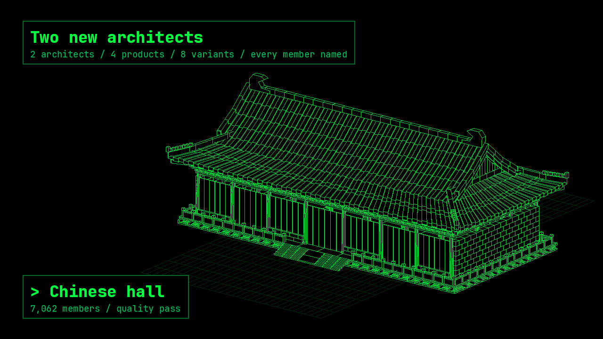

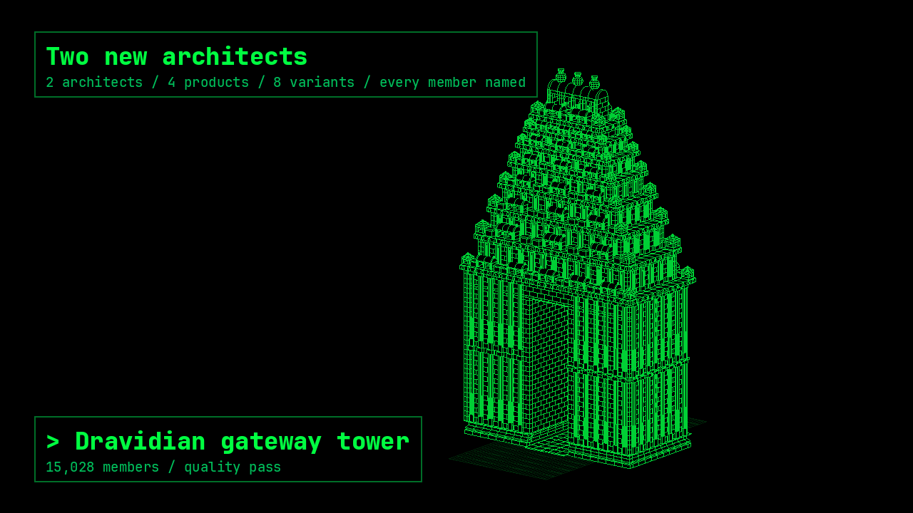


Like the sections below, these architects are in the development build and
are not yet part of this public branch.

## Promo video and new architects (development build)

[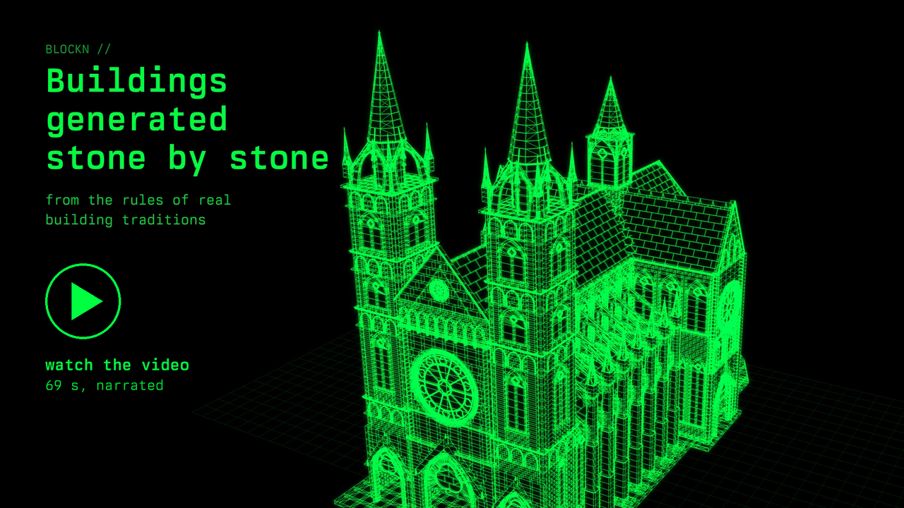](https://newjordan.github.io/BlockN/public/blockn-promo.mp4)

[Watch the 69-second narrated video (MP4, 29 MB)](https://newjordan.github.io/BlockN/public/blockn-promo.mp4)

The video shows the desktop workbench and the `blockn` command line generating
buildings in the development build. New since the last update:

- **Materials and mass**: every member has one of 28 substances, from limestone, brick and oak to slate, lead and glass, with density, strength and friction. Each build reports its total mass, a bill of materials and a vertical load check.
- **Weathering and exports**: surfaces weather by exposure under an `age` control. Builds export to GLB, glTF, OBJ, PLY, STL, OFF, Collada, 3MF and USD, and to FBX through Blender, with a physics manifest that lists every member's substance, mass and friction.
- **Persian Architect**: iwan courts, chahar-taq and caravanserai.
- **Victorian Architect**: two-up-two-down and bay-fronted brick terraces with coped party walls, and a Gothic Revival villa.
- **Settlement planner**: English villages (street, green and market town) and Roman town quarters, with each building made by its own architect.


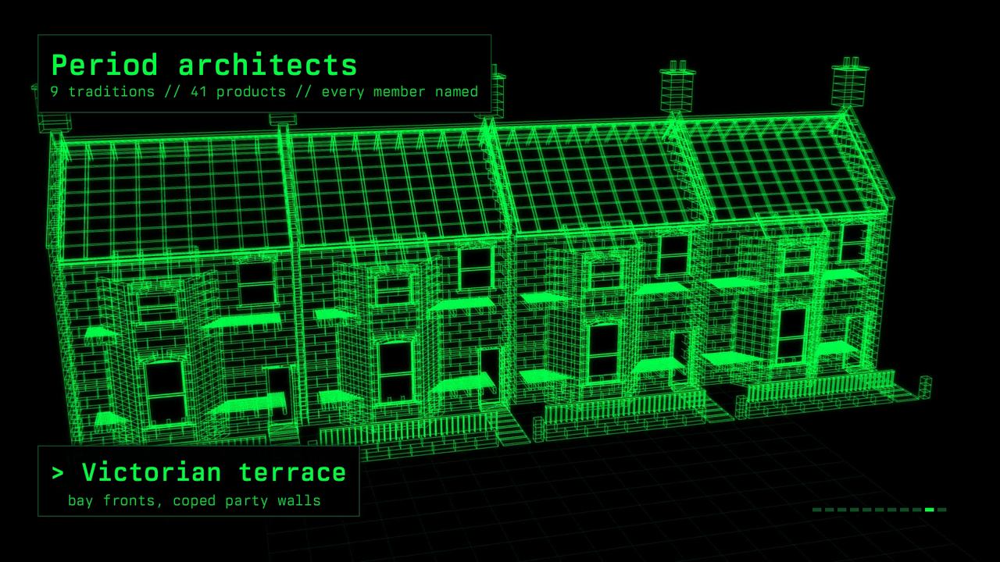


Like the sections below, these features are in the development build and are
not yet part of this public branch.

## Timberwright houses (development build)


Timberwright generates longhouses, gable-front houses, and twin-gable houses.
New houses appear in **green outlines on black**. The GLB export can keep the
wood, plaster, glazing, and roof finishes shown below, or omit materials for
neutral geometry. The generator is in the development build, not this public
classical release.

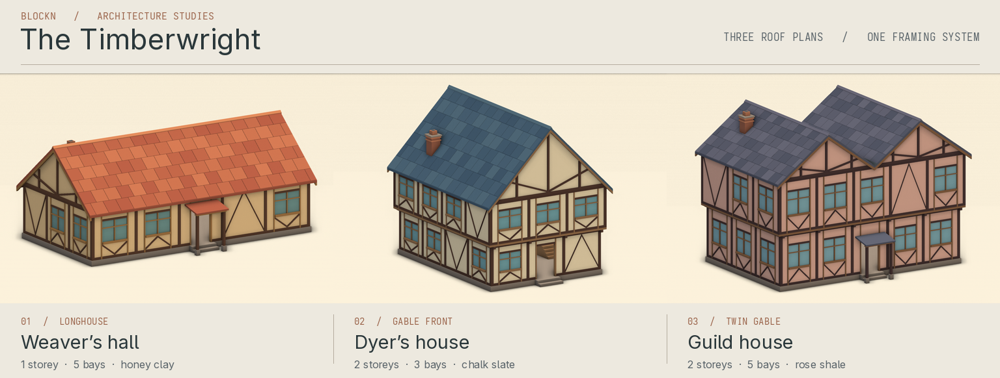

## New: Historic Architects (development build)


Four new architects join the development build of Blocks. Each one composes a
building from the rules of its own tradition, lays the masonry as lift-able
stones, and is then checked against rules measured from the finished geometry.

- **Castle**: Norman great towers (square or round), a shell keep on its motte, and a walled castle with rectangular or drum towers. Keeps are entered at the first floor and stand on a battered plinth.
- **Egyptian**: an axial cult temple with a battered pylon, colonnaded court, clerestoried hypostyle hall and sanctuary. Every span is a single stone beam or slab; nothing is arched.
- **Mesoamerican**: stepped pyramids in three traditions. The radial form has four stairs of exactly 91 steps, which with the platform count 365.
- **Pagoda**: a timber frame of diminishing storeys with bracketed deep eaves around a free central pillar.


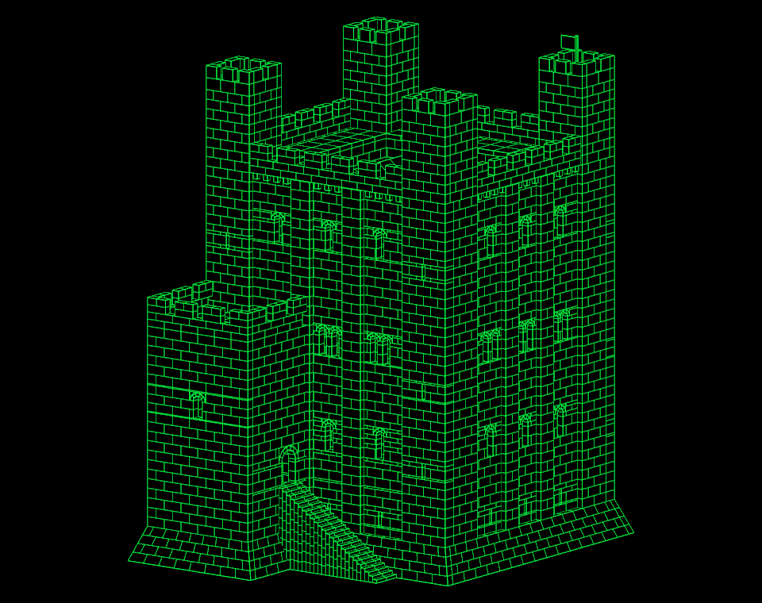


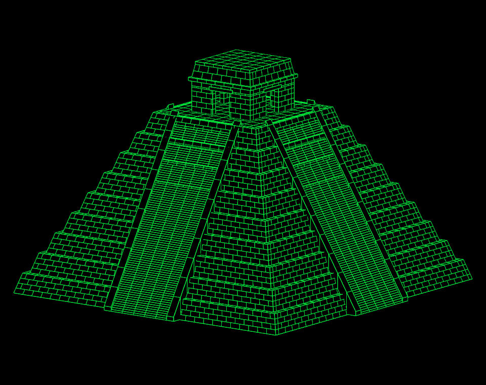

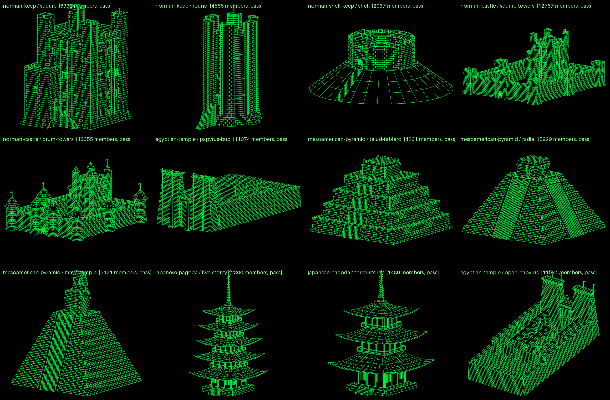

These are original compositions built from each tradition's rules, not
replicas of named monuments. Like the cathedral below, these architects are
not yet part of this public branch.

## Latest Renders: Blocks Architecture System (development build)

These images come from the current development build of Blocks, the semantic
architecture system that grew out of LegoGen. Every member is a named,
human-scale stone, and each render shows real generated geometry in the
green phosphor style of the workbench. The Gothic Cathedral Architect, the
expanded classical forms, and the `blockn` CLI shown here are not yet part of
this public branch.


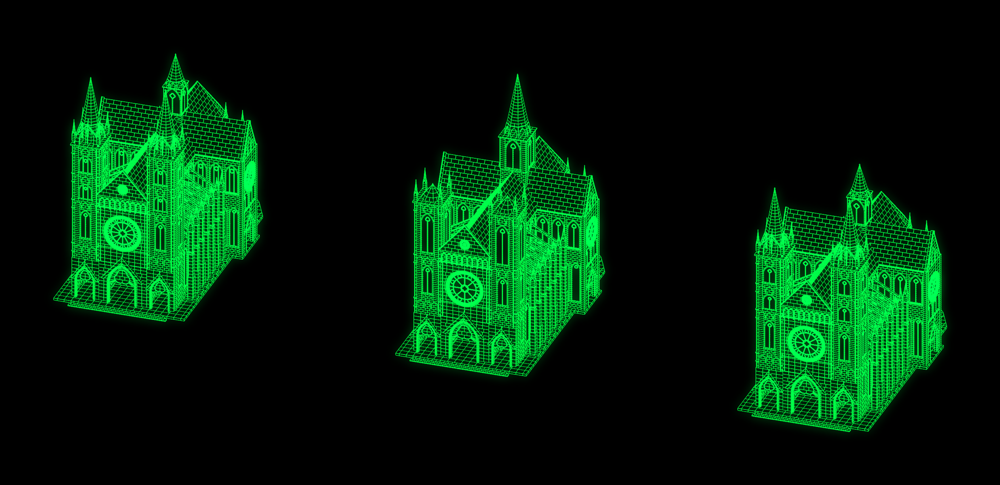


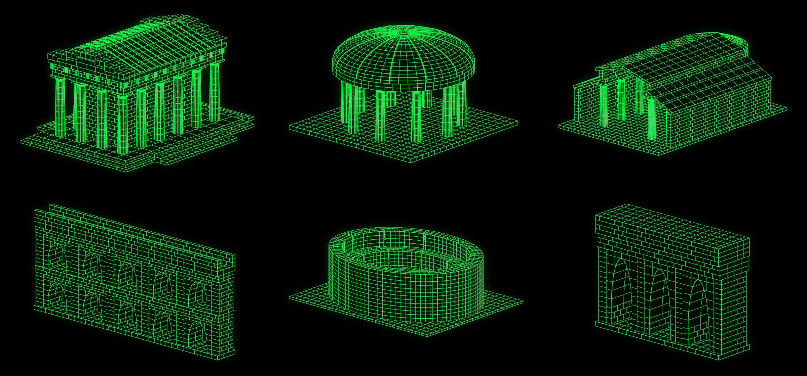

## Screenshots (this branch)

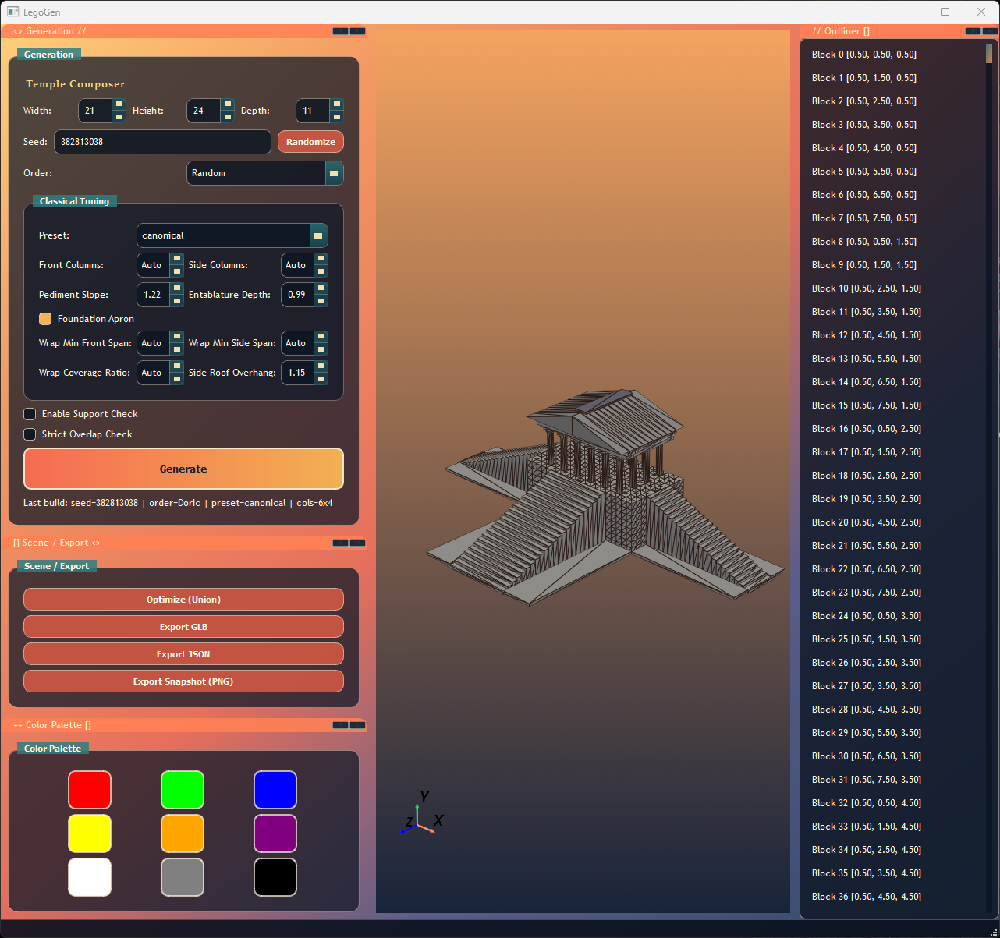


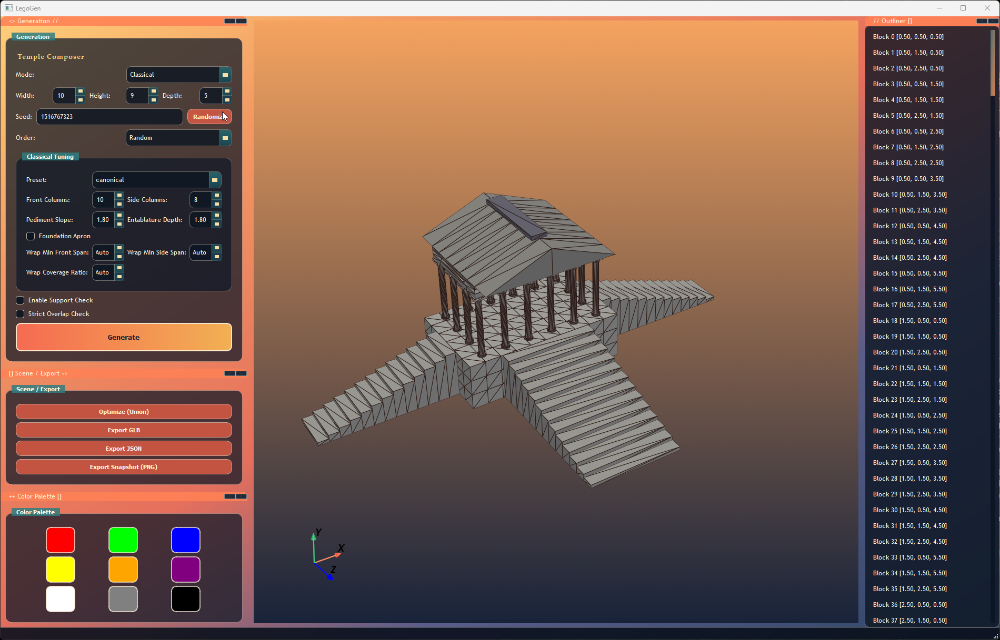

## What Is Included

- PyQt5 + PyVista desktop GUI (`main.py`)
- Headless CLI generation/export (`cli.py`)
- Classical generator with preset/override controls
- GLB, JSON, and PNG export paths
- Unit tests for geometry, scene, and classical generation

## Quick Start

Requires Python 3.10 or newer.

```bash
python3 -m venv .venv-public
source .venv-public/bin/activate  # Windows: .venv-public\Scripts\activate
pip install -r requirements.txt
cp .env.example .env
python3 main.py
```

## Environment Separation

Keep this repo independent from your development repo:

- Public repo venv: `.venv-public`
- Dev repo venv: use a different folder name (for example `.venv-dev`)
- Do not share `.env` files between the two repos

This avoids dependency and config drift between production and experimental work.

## CLI Examples

```bash
python3 cli.py generate --classical-order Doric --seed 123 --out builds/classical.glb --summary
python3 cli.py generate --classical-order Ionic --classical-preset monumental --classical-front-columns 8 --classical-side-columns 8 --classical-pediment-slope 1.1 --classical-entablature-depth 1.2 --classical-side-roof-overhang 1.25 --classical-foundation-apron --width 24 --depth 24 --summary
python3 cli.py generate --classical-order Doric --classical-preset canonical --classical-wrap-min-front-span 22 --classical-wrap-min-side-span 14 --classical-wrap-front-coverage 0.60 --width 20 --height 12 --depth 14 --summary
```

## Tests

```bash
python3 -m unittest tests.test_geometry -v
python3 -m unittest tests.test_scene -v
python3 -m unittest tests.test_classical_generator -v
python3 test_imports.py
```

## License

MIT. See [LICENSE](LICENSE).
