# Block by Block Architect Knowledge According to History

This repository is the public build of BlockN and follows the development of SOTA models with new architecture styles over time.
It carries the full generator: every period architect shown below, the settlement planner, block mode for Minecraft, substances and physics, weathering, every export format, the desktop workbench and the `blockn` CLI.

## Seventeen new architects and architecture sonnets

<a href="https://newjordan.github.io/BlockN/public/blockn-seventeen-architects.mp4">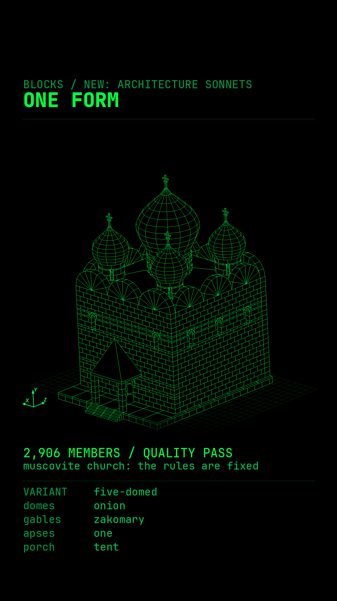</a>

[Watch the 75-second film (MP4, 39 MB, vertical, with sound)](https://newjordan.github.io/BlockN/public/blockn-seventeen-architects.mp4)

This update adds seventeen architects. Every building in the film is a real
build drawn in the workbench's own viewport, and each one passed its quality
gate before it was drawn.

Nine of the new architects are written as **architecture sonnets**. A sonnet
form states the rules its tradition does not break, and names the decisions it
leaves open as *lines*, each with a short list of allowed answers. The seed
answers every line, and the answers together are the building's verse. A
request can pin any line and let the seed write the rest, and `blockn sonnet`
deals variations on one form with no verse repeated. The nine forms can be
written in 472 verses between them, and inside each verse the seed still moves
the plot and the proportions.

- **Mesopotamian**: `mesopotamian-ziggurat`. Receding stages of buttressed baked brick over a sun-dried core, open stairs meeting at an arched gate, and a shrine on the summit.
- **Buddhist Stupa**: `buddhist-stupa`. A solid dome on a terrace drum inside a railed path, with four gateways on the cardinal axes; Sanchi and Sri Lankan dagoba variants.
- **Muscovite**: `muscovite-church`. A white cube with gabled wall bays and eastern apses under five onion domes or an eight-sided tent roof.
- **Great Zimbabwe**: `zimbabwe-enclosure`. Granite laid dry in one closed curve, battered from foot to head, around a solid conical tower.
- **Lalibela**: `lalibela-church`. A church cut down out of the rock, standing in its pit with its roof level with the ground.
- **Art Deco**: `artdeco-tower`. A setback tower massed under New York's 1916 sky-exposure plane, with a tower on no more than a quarter of the lot.
- **Geodesic**: `geodesic-dome`. A subdivided icosahedron with every hub on one sphere, in one or two layers.
- **Tibetan**: `tibetan-palace`. Battered walls with windows that grow toward the roof, as a Potala-type palace or a courtyard dzong.
- **Mughal**: `mughal-tomb`. A domed garden tomb in strict four-fold symmetry, with or without minarets.

Eight more historic architects join them: **Byzantine** (`byzantine-church`,
a cross-in-square church with a pendentive dome, in four plans),
**Sudano-Sahelian** (`sahelian-mosque`), **Imperial Inka** (`inka-kancha`),
**Angkor Khmer** (`khmer-temple-mountain`), **Swahili Coast**
(`swahili-courtyard-house`), **Minangkabau** (`minangkabau-rumah-gadang`),
**Chacoan** (`chacoan-great-house`) and the **Brutalism Studio** (four
concrete briefs).

```bash
blockn sonnet mughal-tomb --describe                 # the form: its lines and answers
blockn sonnet muscovite-church --count 12 --detail concept --output builds/churches
blockn make buddhist-stupa --seed 7 --param anda=bell --bundle builds/stupa
blockn make byzantine-church --variant five-dome --bundle builds/byzantine
```

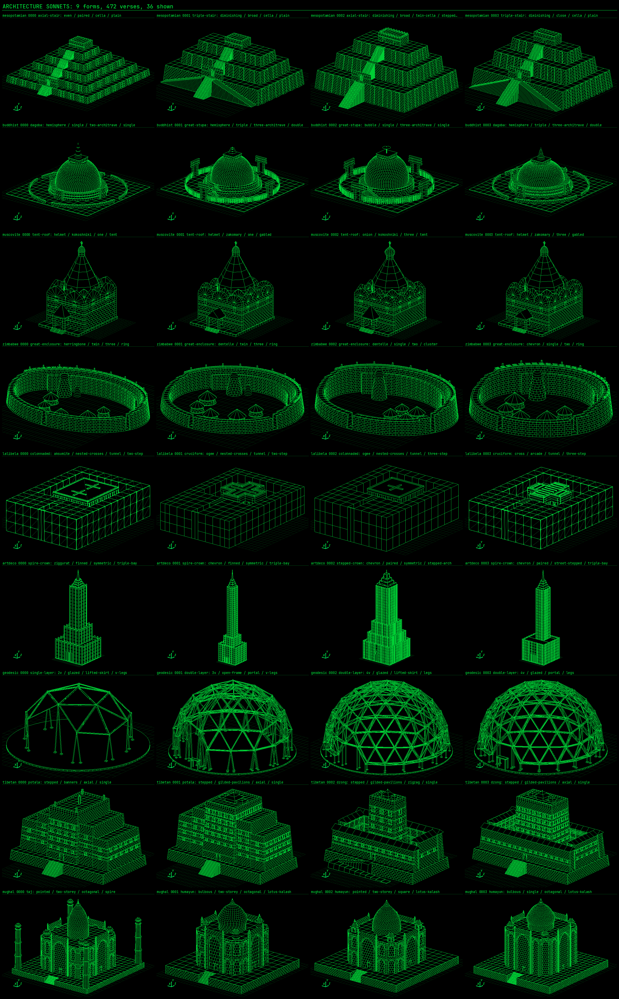
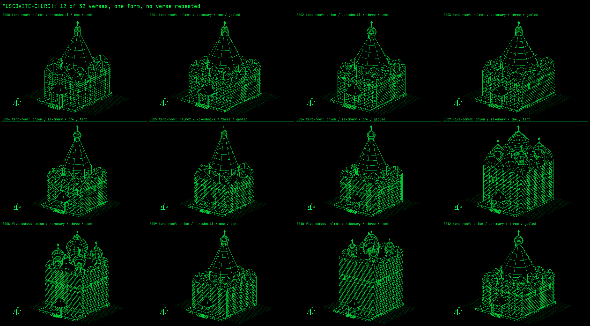

Each architect is audited against rules measured from the finished members.
See [architecture sonnets](docs/ARCHITECTURE_SONNETS.md),
[historic architects](docs/HISTORIC_ARCHITECTS.md) and the
[Brutalism Studio](docs/BRUTALISM_STUDIO.md) for the rules each one follows
and what each model leaves out.

## New architect: Nordic Stave

<a href="https://newjordan.github.io/BlockN/public/blockn-nordic-stave.mp4">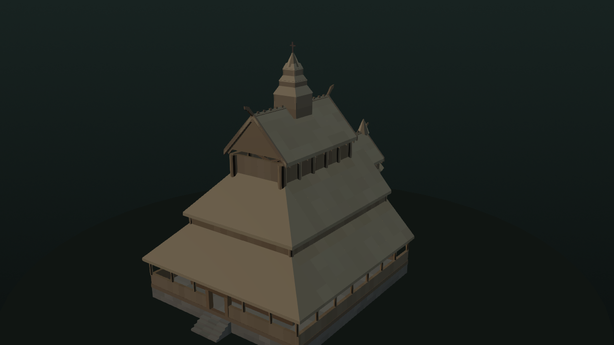</a>

[Watch the 24-second showcase (MP4, 7.8 MB, 1280×720, with sound)](https://newjordan.github.io/BlockN/public/blockn-nordic-stave.mp4)

The showcase follows the Nordic Stave Architect from phosphor CAD member-by-member assembly through an emerald scan wipe into weathered PBR surfaces, including an open-roof cutaway exposing the vertical pine staves, structural rafters, head plates, and St. Andrew's scissor braces:

- **Nordic Stave Architect**: `stave-church` (`borgund`, `single-nave`) and `stave-loft` (`loft-house`, `stabbur`). Vertical tongue-and-groove pine stave planks (`veggtiljer`) and cylindrical staves raised clear of damp ground on a coursed granite foundation sill (`svill`), wrapped by an encircling `svalgang` dwarf-arcade gallery and capped with overlapping cedar shingle courses over structural rafters, mitered hipped lean-to corners, carved oak dragon-head finials (`dragehoder`), pierced ridge crests (`mønekam`), an eastern choir and semicircular apse, and a multi-tiered `takrytter` ridge turret. The `stabbur` raises a cantilevered two-storey storehouse on six mushroom-capped granite `stabbe` piers. Seven measured geometric rules.


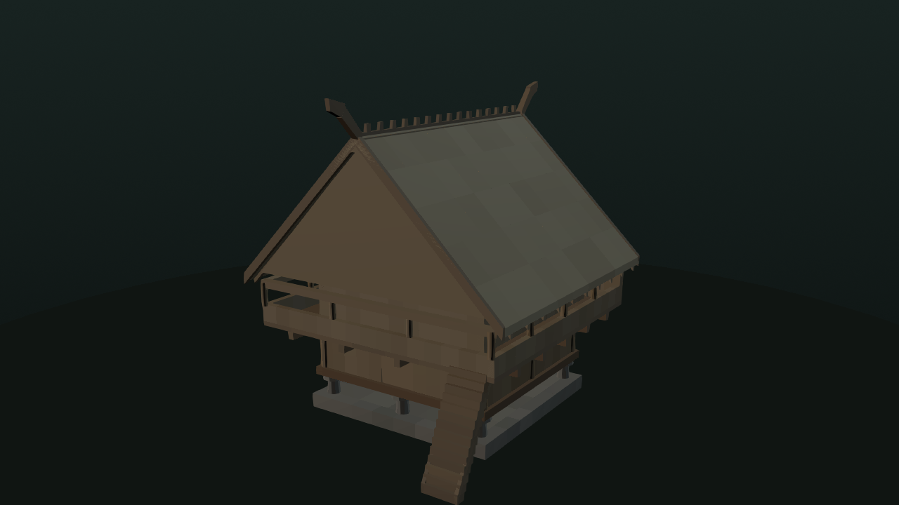

## Two new architects: Chinese and Dravidian

<a href="https://newjordan.github.io/BlockN/public/blockn-two-architects.mp4">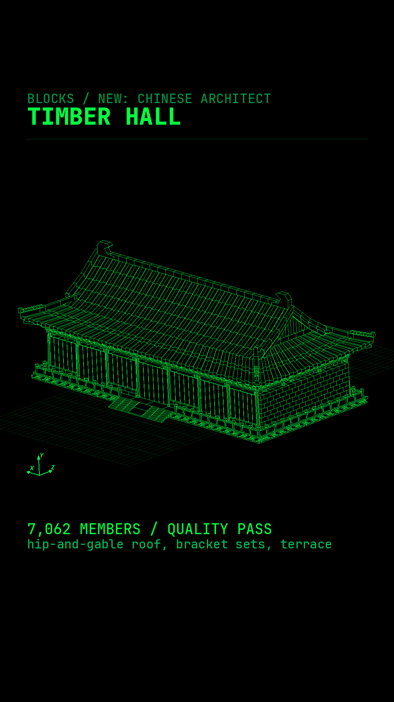</a>

[Watch the 37-second demo (MP4, 37 MB, vertical, with sound)](https://newjordan.github.io/BlockN/public/blockn-two-architects.mp4)

The demo shows each building assembling itself member by member in the
workbench's own viewport. The member counts and quality results on screen
come from the builds themselves. Two more architects join BlockN:

- **Chinese Architect**: `chinese-hall` and `chinese-palace-hall`. A timber hall on a stone terrace, with bays that shorten outward from the widest middle one, bracket sets measured in doukou, roof courses that steepen toward the ridge, eaves that lift at the corners, owl-tails on the ridge and a line of beasts down every hip. The palace hall raises a second eave over nine bays.
- **Dravidian Architect**: `dravidian-gopuram` and `dravidian-vimana`. A gateway tower of diminishing talas, each under its prastara, kudu arches and a parapet of miniature shrines, with a passage that runs open through the stone base. The vimana is granite throughout, raised over a pillared hall.


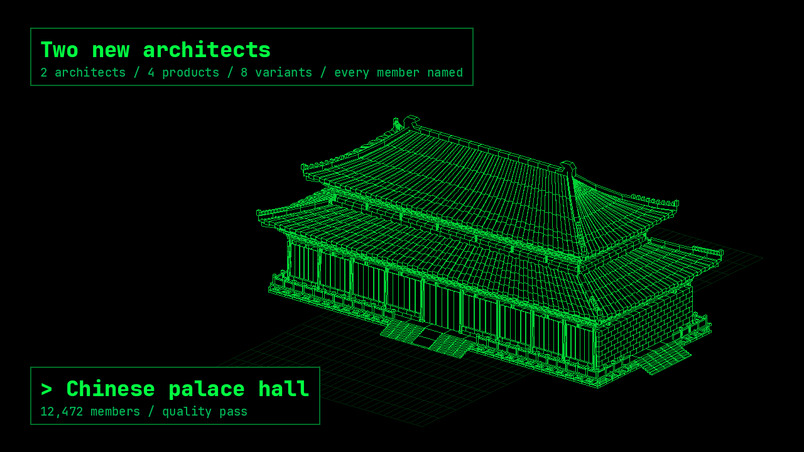

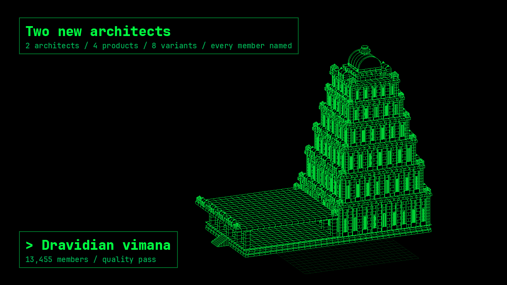

## Promo video and new architects

[](https://newjordan.github.io/BlockN/public/blockn-promo.mp4)

[Watch the 69-second narrated video (MP4, 29 MB)](https://newjordan.github.io/BlockN/public/blockn-promo.mp4)

The video shows the desktop workbench and the `blockn` command line generating
buildings. New since the last update:

- **Materials and mass**: every member has one of 28 substances, from limestone, brick and oak to slate, lead and glass, with density, strength and friction. Each build reports its total mass, a bill of materials and a vertical load check.
- **Weathering and exports**: surfaces weather by exposure under an `age` control. Builds export to GLB, glTF, OBJ, PLY, STL, OFF, Collada, 3MF and USD, and to FBX through Blender, with a physics manifest that lists every member's substance, mass and friction.
- **Persian Architect**: iwan courts, chahar-taq and caravanserai.
- **Victorian Architect**: two-up-two-down and bay-fronted brick terraces with coped party walls, and a Gothic Revival villa.
- **Settlement planner**: English villages (street, green and market town) and Roman town quarters, with each building made by its own architect.

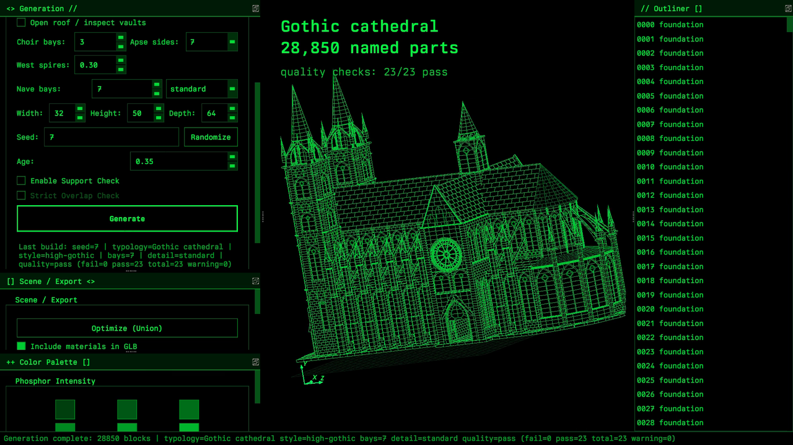
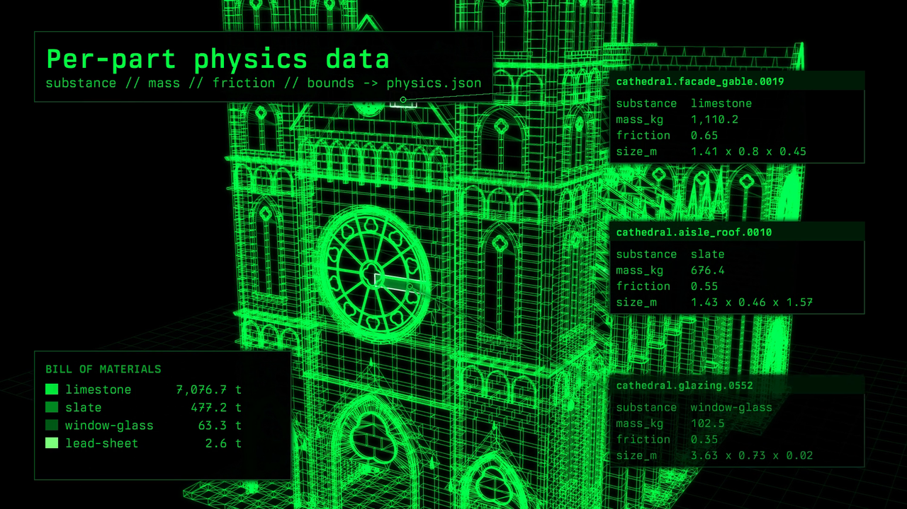

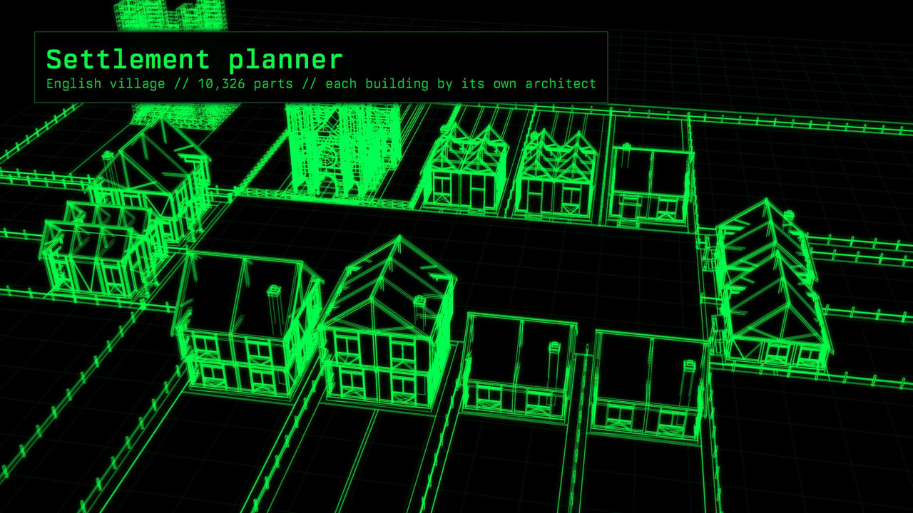

## Timberwright houses

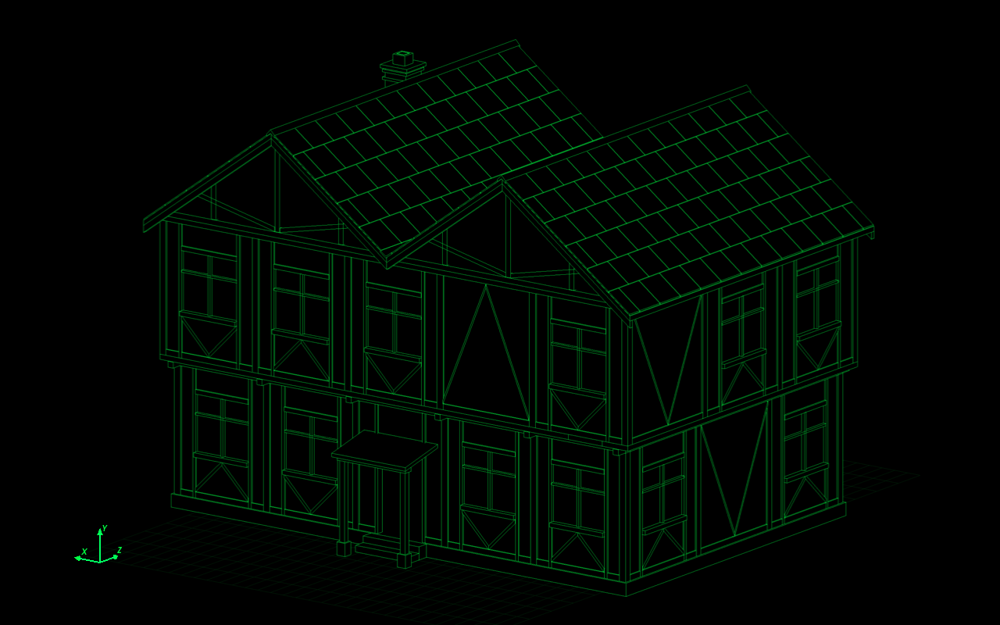

Timberwright generates longhouses, gable-front houses, and twin-gable houses.
New houses appear in **green outlines on black**. The GLB export can keep the
wood, plaster, glazing, and roof finishes shown below, or omit materials for
neutral geometry.


## New: Historic Architects

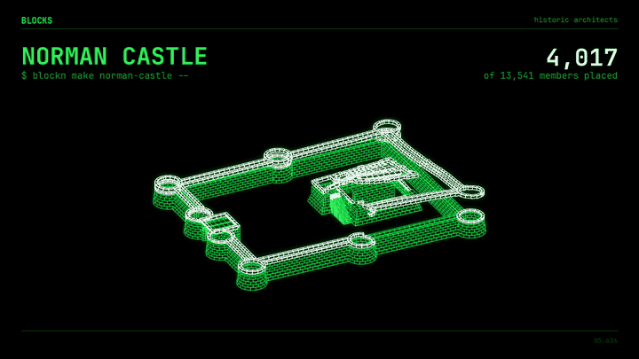

Four new architects join BlockN. Each one composes a
building from the rules of its own tradition, lays the masonry as lift-able
stones, and is then checked against rules measured from the finished geometry.

- **Castle**: Norman great towers (square or round), a shell keep on its motte, and a walled castle with rectangular or drum towers. Keeps are entered at the first floor and stand on a battered plinth.
- **Egyptian**: an axial cult temple with a battered pylon, colonnaded court, clerestoried hypostyle hall and sanctuary. Every span is a single stone beam or slab; nothing is arched.
- **Mesoamerican**: stepped pyramids in three traditions. The radial form has four stairs of exactly 91 steps, which with the platform count 365.
- **Pagoda**: a timber frame of diminishing storeys with bracketed deep eaves around a free central pillar.

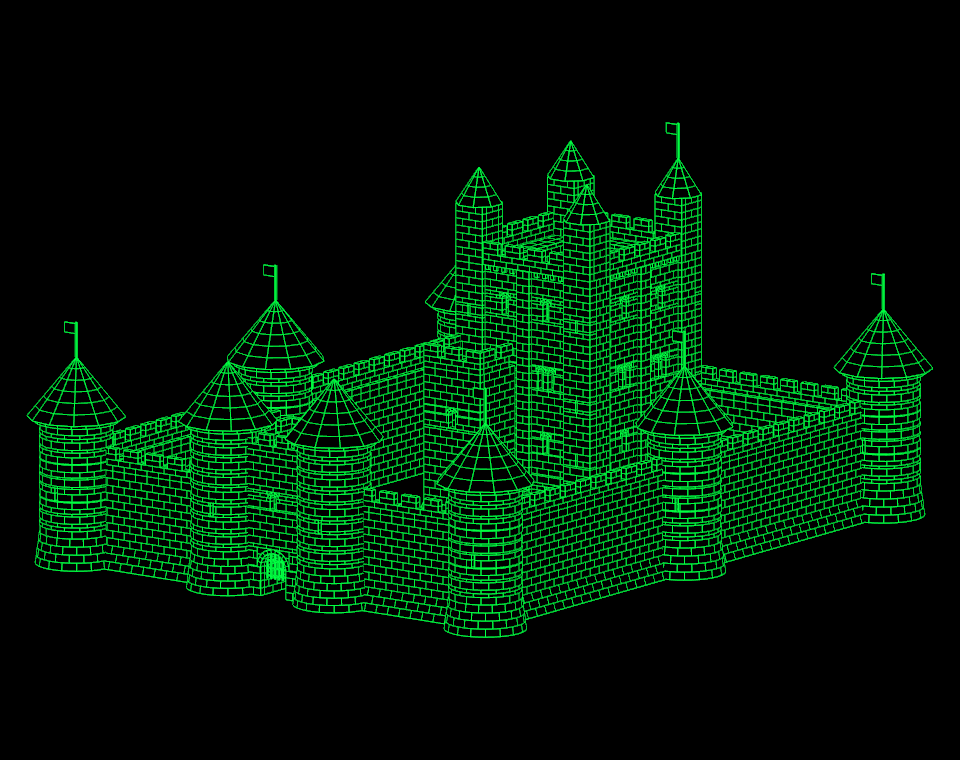

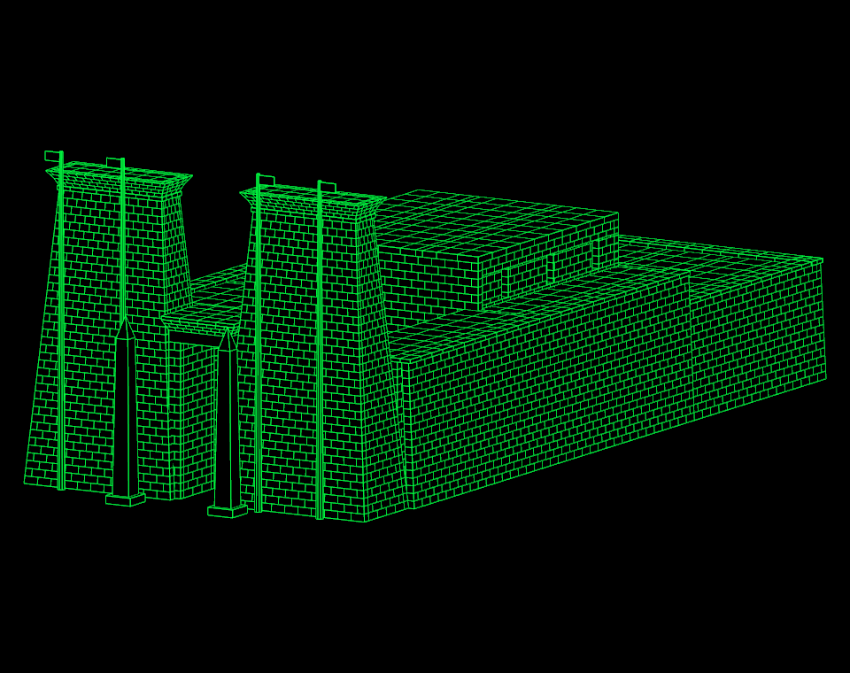
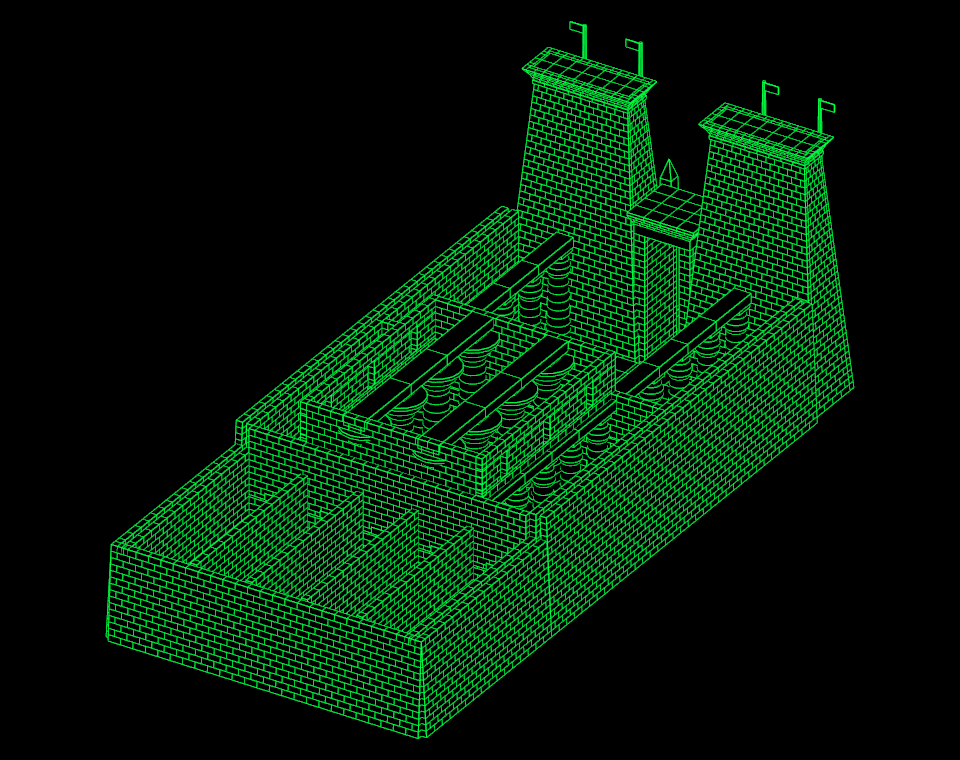


These are original compositions built from each tradition's rules, not
replicas of named monuments.

## Latest Renders: Blocks Architecture System

These images come from the Blocks architecture system that grew out of
LegoGen. Every member is a named, human-scale stone, and each render shows
real generated geometry in the green phosphor style of the workbench.

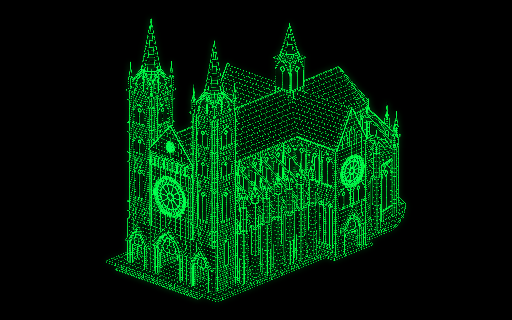
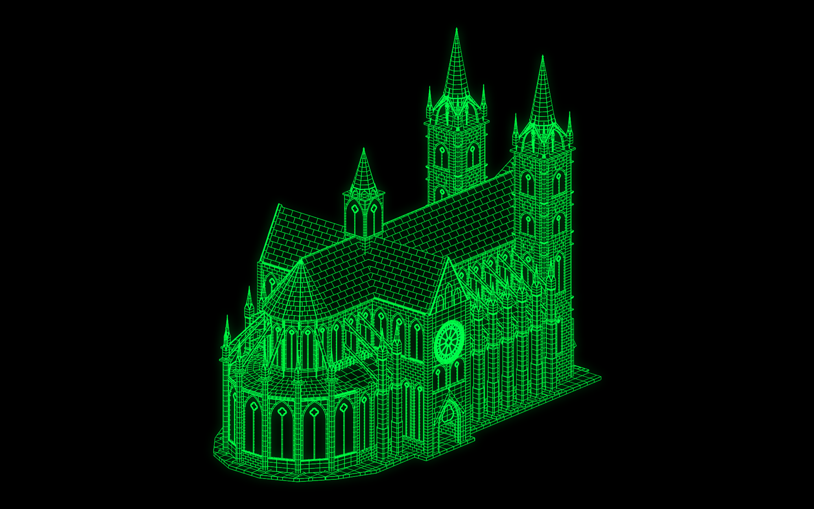
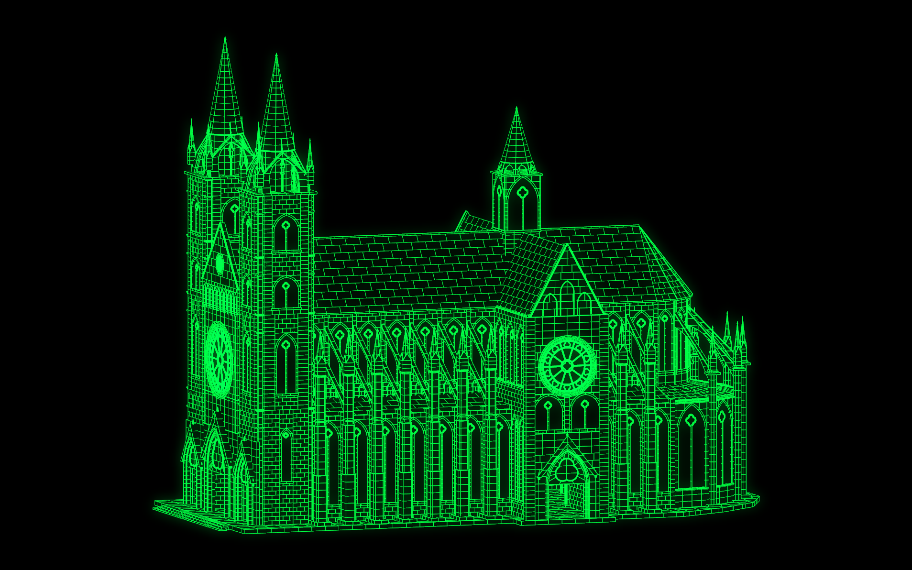

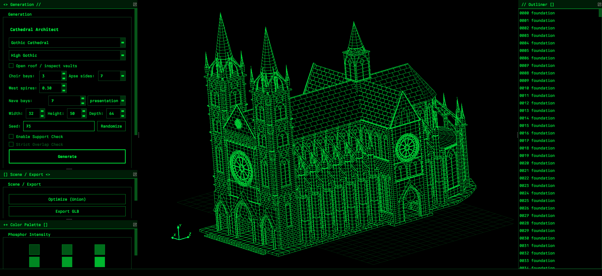
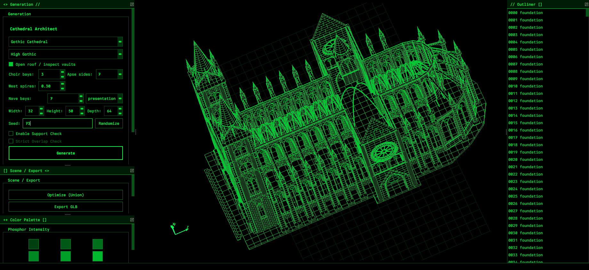


## Block mode and regional styles

Block mode designs straight onto Minecraft's 1 m grid instead of voxelizing exact geometry. Walls, roof pitches, stairs and doors are whole blocks, and every block carries its Minecraft block state. It builds castles, village streets, furnished houses, towers, workshops, windmills, mines, cliff apartments and castle towns fitted to a height map, and exports `.mcfunction` commands, voxel grids and Java 1.21 world saves.

- **Style sub-architects**: Tudor merchant house, Hanseatic gable house, Norse longhouse, Alpine chalet, Mediterranean courtyard house, Pueblo terrace and English seld.
- **Regional town layouts**: Pueblo plaza, Norse farm village and Mediterranean courtyard blocks, picked by climate.
- **Construction rules**: a knowledge base and rule checker score each building and town against real construction practice. See [docs/ARCHITECTURE_RULES.md](docs/ARCHITECTURE_RULES.md) and [docs/BLOCK_MODE.md](docs/BLOCK_MODE.md).

```bash
python cli.py voxels castle --blocks --profile blocky --seed 1 --out out/castle --name castle --render
python cli.py voxels village --blocks --out out/village --name village --render
```

## Classical screenshots


## What Is Included

- 47 built-in products: walls, columns, stairs, roofs, facades, structural grids, classical buildings, the Gothic cathedral, Timberwright houses, castles, Egyptian temples, Mesoamerican pyramids, pagodas, Persian iwan courts, Victorian terraces, Chinese halls, Dravidian towers, Nordic stave churches and lofts
- Settlement planner for English villages and Roman town quarters
- Block mode with style sub-architects and regional town layouts for Minecraft export
- 28 substances with mass, a bill of materials and a vertical load check per build
- Weathered PBR surfaces and exports to GLB, glTF, OBJ, PLY, STL, OFF, Collada, 3MF, USD and FBX (through Blender), with a physics manifest
- PyQt5 + PyVista desktop workbench (`main.py`) and the `blockn` CLI (`cli.py`)
- Unit tests for every architect

## Quick Start

Requires Python 3.10 or newer.

```bash
python3 -m venv .venv
source .venv/bin/activate  # Windows: .venv\Scripts\activate
python -m pip install -e '.[gui,config,export]'
blockn catalog
blockn architects
blockn make stave-church --bundle builds/stave-church
blockn-gui
```

Every command can also be written as `python -m blockn ...`. See [docs/ARCHITECTURE.md](docs/ARCHITECTURE.md) for the data contracts and extension model.

## Legacy classical command

```bash
blockn generate --classical-order Doric --classical-preset canonical --seed 123 --width 20 --height 12 --depth 14 --out builds/classical.glb --summary
```

## Tests

```bash
python -m pip install pytest pytest-xdist scipy networkx
python -m pytest tests -n auto
python test_imports.py  # full CLI + GUI import check
```

## License

MIT. See [LICENSE](LICENSE).
