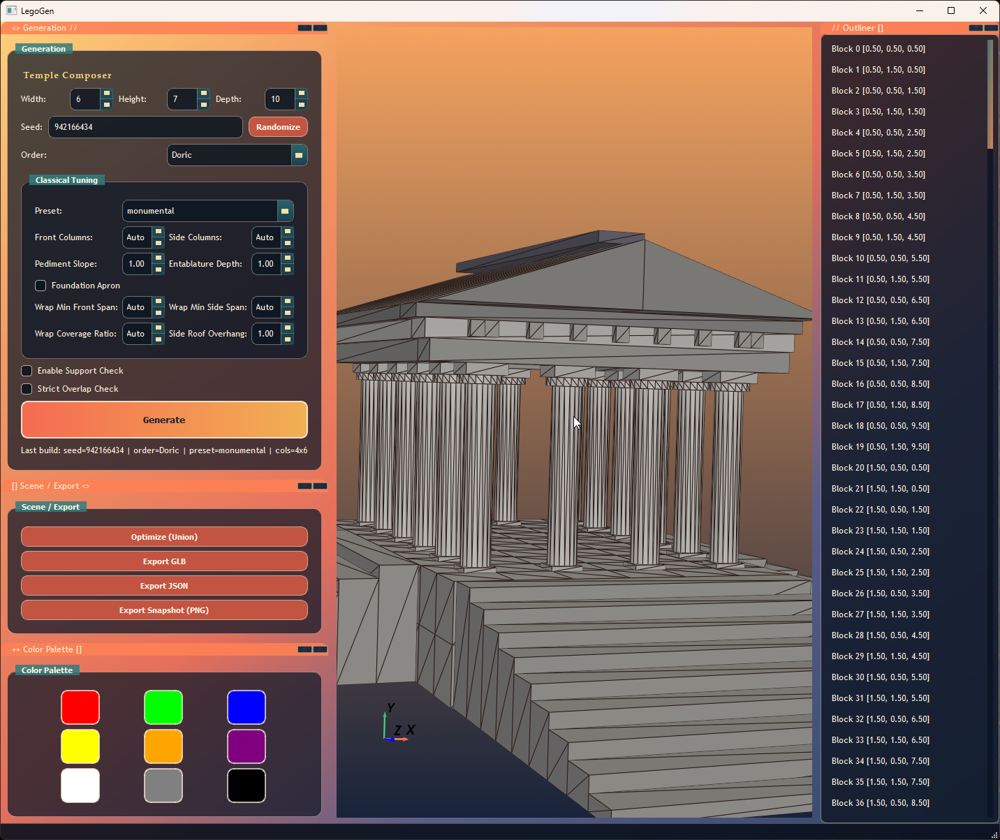
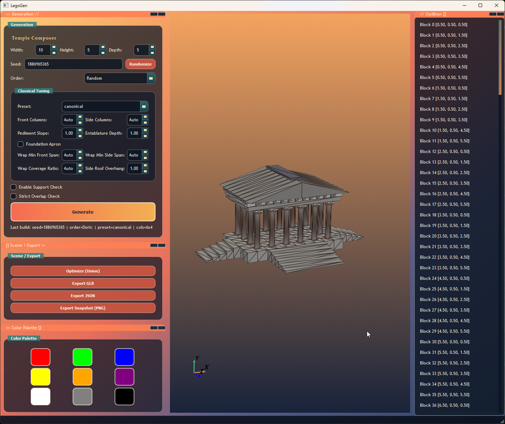
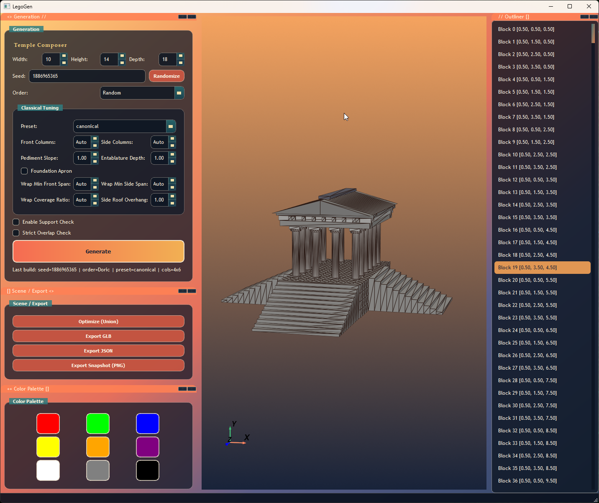

# BlockN

BlockN's public build generates a Greek temple from Doric and Ionic rules and shows it in a desktop workbench. Every member is a block: cubes for the podium, entablature, and stairs, cylinders for column shafts, and wedges for the pediment.

This repository is that classical generator, the workbench, and the export tools. Promotional images and video under `public/` for other architects (Chinese, Dravidian, Gothic, Victorian, and the rest) are reference media. Those generators are not in this branch, and this code does not produce them.







## What you can generate

- **Orders:** Doric and Ionic, or `Random` (chosen from those two by the seed). The alias `ioinic` resolves to Ionic.
- **Presets:** `compact`, `canonical`, and `monumental`. They scale column diameter, spacing, entablature depth, pediment slope, and the column caps.
- **Members:** podium, colonnade, architrave, frieze (Doric triglyphs or an Ionic relief band), cornice, pediment, roof, and ridge.
- **Circulation:** a front stair and side exit stairs. Large footprints can add wrap stairs. A foundation apron and doorway thresholds are optional. Entrance markers are optional and off unless requested.
- **Controls:** front and side column counts, pediment slope, entablature depth, side roof overhang, and the wrap-stair thresholds. Column count `0` means the generator fits an even count to the facade.

Width and depth below 6 are raised to 6 so a four-column facade can fit. Podium height is the integer third of the requested height, and at least 1. The same seed, order, preset, and overrides rebuild the same temple.

Block positions are geometric centers. Dimensions are width (X), height (Y), and depth (Z).

## Requirements

Python 3.10 or newer.

The generator needs NumPy, SciPy, Trimesh, and manifold3d. Overlap checks use python-fcl when it imports, and a mesh-volume check when it does not. The workbench needs PyQt5, PyVista, pyvistaqt, and VTK.

No model weights are downloaded. The OpenAI and Blender entries in `.env.example` are accepted and unused. `core/blender_union_script.py` can boolean-union meshes inside Blender, but neither the workbench nor the `blockn` command calls it.

## Setup

```bash
python3 -m venv .venv
source .venv/bin/activate
python -m pip install --upgrade pip
python -m pip install -e ".[gui]"
```

`pip install -r requirements.txt` installs the same runtime packages without the `blockn` command. `setup.sh` (and `setup.bat` on Windows) creates `.venv`, installs the package with the GUI and test extras, and runs the tests.

Copy `.env.example` to `.env` only when you want to change the built-in defaults. The file is optional. `DEFAULT_WIDTH`, `DEFAULT_HEIGHT`, and `DEFAULT_DEPTH` set the workbench spin boxes and the CLI defaults. Export folders are created when you export, not when configuration is read.

## Workbench

```bash
python main.py
```

The window is **BlockN Classical Workbench**.

- **Controls** is one scrolling column: generation, export, and color. Generation sets size, seed, order, preset, column counts, proportions, wrap thresholds, and the foundation apron. An empty seed is filled with the value actually used, so the temple can be rebuilt. A non-integer seed is rejected. Export unions same-colored meshes, then writes GLB or JSON. **Export Snapshot (PNG)** saves the viewport. Color picks a swatch; click a block in the viewport to paint it. The selected swatch keeps a gold border.
- **Outliner** lists each member by id, element, and position. Click a row to highlight that block.

Generate builds the full temple. Overlap and support filters are turned off while the pieces are placed, then restored. Leaving overlap on used to drop intersecting cornices, pediment wedges, and stairs.

## Command line

```bash
blockn generate --classical-order Doric --seed 7 --width 10 --height 6 --depth 8 --summary
blockn generate --classical-order Ionic --classical-preset monumental --classical-front-columns 8 --classical-side-columns 8 --width 24 --depth 24 --out exports/ionic.glb --summary
blockn generate --classical-order Doric --classical-preset canonical --classical-foundation-apron --classical-wrap-min-front-span 18 --classical-wrap-min-side-span 12 --classical-wrap-front-coverage 0.54 --width 20 --depth 14 --json exports/scene.json --summary
```

`python cli.py generate ...` does the same thing. `--summary` prints the block count, mesh bounds, order, preset, footprint, column counts, and whether the placement checks passed. `--width`, `--height`, and `--depth` must be positive. `--optimize` unions meshes of the same color before the GLB export.

## Tests

```bash
python -m pip install -e ".[gui,dev]"
python -m pytest
```

GitHub Actions runs that install and `pytest` on Python 3.11 and 3.12. `python test_imports.py` checks that the runtime imports load and exits non-zero when one fails.

## License

MIT. See [LICENSE](LICENSE).
