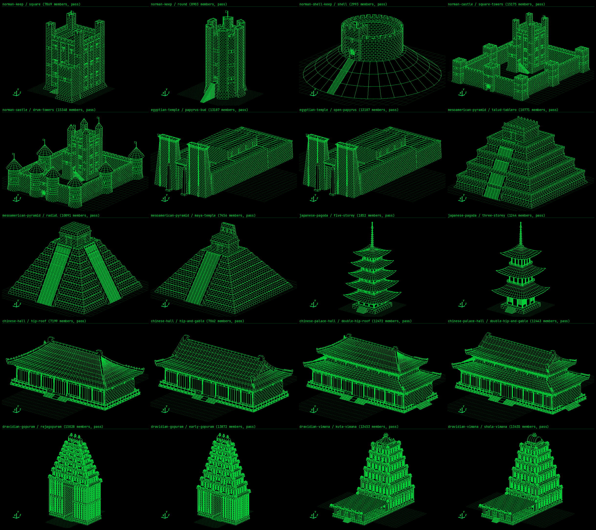

# Historic Architects

Fourteen architects extend BlockN beyond the classical and Gothic catalog. Each one
is a small rule system for one building tradition: it decides proportions,
members and openings from the tradition's own logic, and is then audited
against rules measured from the finished geometry.

| Architect | Products | Variants |
| --- | --- | --- |
| Castle | `norman-keep` | `square`, `round` |
| | `norman-shell-keep` | `shell` |
| | `norman-castle` | `square-towers`, `drum-towers` |
| Egyptian | `egyptian-temple` | `papyrus-bud`, `open-papyrus` |
| Mesoamerican | `mesoamerican-pyramid` | `talud-tablero`, `radial`, `maya-temple` |
| Pagoda | `japanese-pagoda` | `five-storey`, `three-storey` |
| Chinese | `chinese-hall` | `hip-roof`, `hip-and-gable` |
| | `chinese-palace-hall` | `double-hip-roof`, `double-hip-and-gable` |
| Dravidian | `dravidian-gopuram` | `rajagopuram`, `early-gopuram` |
| | `dravidian-vimana` | `kuta-vimana`, `shala-vimana` |
| Nordic Stave | `stave-church` | `borgund`, `single-nave` |
| | `stave-loft` | `loft-house`, `stabbur` |
| Sudano-Sahelian | `sahelian-mosque` | `djenne` |
| Imperial Inka | `inka-kancha` | `cusco-court` |
| Angkor Khmer | `khmer-temple-mountain` | `angkor-wat` |
| Swahili Coast | `swahili-courtyard-house` | `single-court`, `double-court` |
| Minangkabau | `minangkabau-rumah-gadang` | `bodi-caniago`, `koto-piliang` |
| Chacoan | `chacoan-great-house` | `single-kiva`, `paired-kivas` |
| Byzantine | `byzantine-church` | `four-column`, `two-column`, `five-dome`, `four-pier` |
| [Brutalism Studio](BRUTALISM_STUDIO.md) | `brutalist-civic-center`, `brutalist-housing`, `brutalist-arts-center`, `brutalist-portal-field` | Two variants per brief |

Nine more traditions (Mesopotamian ziggurat, Buddhist stupa, Muscovite church,
Great Zimbabwe, Lalibela, Art Deco tower, geodesic dome, Tibetan palace and
Mughal tomb) are written as [architecture sonnets](ARCHITECTURE_SONNETS.md):
historic architects whose open decisions are named lines that can be pinned,
read and dealt as variations.

```bash
python3 -m blockn describe norman-castle
python3 -m blockn make norman-keep --variant round --bundle builds/round-keep
python3 -m blockn make norman-castle --variant drum-towers --bays 2 --bundle builds/castle
python3 -m blockn make mesoamerican-pyramid --variant radial --bundle builds/calendar-pyramid
python3 -m blockn make egyptian-temple --variant open-papyrus --bundle builds/temple
python3 -m blockn make japanese-pagoda --variant three-storey --height 24 --bundle builds/pagoda
python3 -m blockn make chinese-palace-hall --bundle builds/palace-hall
python3 -m blockn make dravidian-gopuram --levels 11 --bundle builds/gopuram
python3 -m blockn make dravidian-vimana --variant shala-vimana --bundle builds/vimana
python3 -m blockn make stave-church --variant borgund --bundle builds/stave-church
python3 -m blockn make stave-loft --variant stabbur --bundle builds/stabbur
python3 -m blockn make sahelian-mosque --variant djenne --bays 5 --bundle builds/djenne
python3 -m blockn make inka-kancha --variant cusco-court --bays 2 --bundle builds/inka-kancha
python3 -m blockn make khmer-temple-mountain --variant angkor-wat --bays 4 --bundle builds/angkor
python3 -m blockn agent build examples/world-architecture.json --output builds/world
```



`python3 scripts/render_historic_sheet.py` redraws the sheet from real builds,
and refuses to draw one that is not a clean `pass`.

`python3 scripts/render_two_architects_demo.py` records the Chinese and
Dravidian architects building themselves into a 37-second vertical film with a
synthesized score, and `--posters` renders a still of each product. A build is
paced by the stages its architect laid its members in, so the columns of a hall
rise one after another instead of arriving in a single frame. Member counts and
quality results in the captions are read from the builds. Frames are rendered
offline at 30 fps into `builds/two-architects-demo/`, and the script measures
the finished file's loudness, sound sync and frame-to-frame change; that frame
rate is not an interactive-performance measurement.

`python3 scripts/render_blocks_showcase.py` renders the full BlockN vertical
launch showcase: a 107.5-second narrated 1080×1920 film combining the workbench's
perspective phosphor CAD language with weathered PBR studio renders from
`core/architecture/surfaces.py`. The Chinese and Dravidian architects assemble
in member order, materialize into weathered substances across emerald laser-scan
sweeps, open the Chinese roof to expose the bare softwood timber frame, and pin
3D world-tracked callouts and measured rule checks directly onto the finished
geometry. An eight-build weathered PBR reel highlights the broader 45-product,
20-architect catalog (including Persian, Victorian, Gothic, Castle, Pagoda, Maya,
and Settlement planners) and multi-format physics-ready exports, followed by live
parametric seed mutation and a 15-building randomized `agent series` batch grid
cascade before closing on the open-source model challenge. Narration and bespoke
score/SFX stems are generated with ElevenLabs (`--fetch-audio` requires
`ELEVENLABS_API_KEY`) and reused on subsequent renders; `--stills` renders single
review frames, and `--remix` remixes sound onto an existing picture. Output goes
to `builds/blocks-showcase/`.

In the desktop, pick the product in the form list and its tradition in the
style list. **Open roof** hides roof members so the spine wall, columns or
frame can be inspected; export always includes the whole building.

These are original compositions built from each tradition's rules. They are
not replicas of named monuments, and the monuments mentioned below are the
places a rule can be seen, not measured sources. Dimensions are metres.
Width, height and depth describe the whole composition; a banner mast or
flagstaff may stand a little above the stated height.

## How masonry is built

An ashlar wall is built as a facing laid in running bond, in
stones no taller than 0.8 m and no longer than 1.6 m, the same gate the
classical catalog uses. Thick walls are built as they were: two facings with a
core of large blocks between them, laid to break joint. The core stays open
behind every window, so a light is a through embrasure and not a blind recess.
Pyramid terraces, pylon towers and the pagoda podium are filled the same way. Battered and sheared members are laid in the same bond
and then leaned, so their joints stay continuous. Round-headed openings are
real arches: an odd number of voussoirs with a keystone, and coursed spandrels
above. Curved walls are radial stones with staggered joints.

Three kinds of member are deliberately single pieces, because they were:
Egyptian architraves, lintels, roof slabs and obelisks; Mesoamerican door
lintels; and timber posts, beams and rafters.

## Block count

Every build reports how many pieces it takes to raise it. The count is in the
document metadata under `<architect>_rules.block_count`, split into
`cut_stones`, `core_blocks`, `monoliths`, `timbers` and `other_members`, with a
`total` equal to the number of placements. Because cores are filled, the total
is the whole bill and not only the visible facing. A default square keep is
about 11,900 blocks at standard detail, about 1,550 of them core.

## Variation

The seed varies each building inside the range of its tradition. It moves
proportions such as wall thickness, plinth height, turret rise, storey heights,
pylon depth, nave and aisle heights, terrace lean, shrine size, eave depth and
roof curve; the bay ratio, terrace height and corner lift of a Chinese hall;
the base, taper and passage of a Dravidian tower. It can put a keep's
forebuilding on either hand and move a keep off the axis of its ward. It never moves the outer dimensions, which stay as
requested, and every seed must still pass every rule.

`--param variation=N` scales this from 0 to 1. The default is 1. At 0 the
architect builds its canonical proportions whatever the seed.

```bash
python3 -m blockn make norman-keep --seed 4 --bundle builds/keep-4
python3 -m blockn make norman-keep --seed 4 --param variation=0 --bundle builds/keep-canonical
```

## Castle Architect

The massing descends from the castle kit in angelX (great keep, round tower,
curtain run, gatehouse), rebuilt at full scale. The rules follow English work
of about 1070 to 1220.

| Rule | In the model |
| --- | --- |
| Entrance at the first floor | The keep door stands a storey above ground, reached by a stair to a forebuilding (square) or by a stair and timber bridge (round) |
| Battered plinth | The foot spreads by about 4.5% of the plan, up to 1.1 m |
| Wall thickness | About 17% of the plan for a square keep, 30% of the radius for a round one |
| Stiffening | Shallow pilasters between bays and clasping corner turrets that rise above the parapet |
| Hidden roofs | Twin roofs below the wall-walk, either side of a spine wall with a doorway at each floor |
| Halved spans | Each floor is oak joists from the outer wall to the spine wall, boarded over; the spine wall is there to halve that span |
| Windows widen upward | Loops at the basement, single round-headed lights above, paired lights at the hall |
| Parapet | A 0.9 m breast wall and 0.9 m merlons cover a standing defender |
| Tower plan by date | `square-towers` gives rectangular mural towers and a gate tower; `drum-towers` gives battered drums with conical caps and a twin-drum gate, the form that arrives around 1200 |

`norman-keep` takes `--bays` 2–4 (window bays per face) and `--levels` 3–5
(storeys). The `round` variant is a cylindrical keep with six wedge
buttresses. `norman-shell-keep` is a ring wall on an earth motte with a 36.5°
slope and a stair cut into it. `norman-castle` takes `--bays` 0–3, the number
of mural towers between the corners of each long side; its keep is always the
square great tower, since many castles kept a Norman keep and modernised the
walls around it. Wards use the next coarser stone so large fields stay legible.

The gate passage is a barrel vault of voussoir rings with a half-raised
portcullis. Rules can be seen at Rochester and Hedingham (square keeps),
Conisbrough (round keep), and Restormel (shell keep).

## Egyptian Architect

A New Kingdom cult temple laid out on one processional axis: pylon, open court
with side colonnades, hypostyle hall, sanctuary chambers.

| Rule | In the model |
| --- | --- |
| Trabeated | Every span is a single stone beam or slab; there is no arch anywhere |
| Slab span sets spacing | Column pitch is 4.6 column radii, kept between 2.6 and 5.5 m |
| Battered pylon | Each tower leans in on all four faces by about 1 in 9, under a torus and cavetto cornice |
| Clerestory | The nave columns are taller than the aisle columns (aisle = 70%); stone grilles light the nave over the first aisle row |
| Falling roofs, rising floors | Pylon, nave, aisles and sanctuary step down in that order while the floor rises 0.3 m at each threshold by a ramp |
| Plant columns | Aisle and court columns are closed papyrus buds. `open-papyrus` gives the nave spreading bell capitals; `papyrus-bud` keeps buds throughout |
| Sanctuary | An odd number of parallel chambers no wider than a slab can span, the middle one holding the shrine |

Two obelisks and four flagstaffs stand before the pylon. The arrangement can
be seen at the Temple of Khonsu at Karnak and at Edfu; the clerestory at the
Great Hypostyle Hall of Karnak.

## Mesoamerican Architect

A stepped pyramid: cut-stone facing over a rubble and earth core, a
balustraded stair, a summit temple. Openings are lintelled; no true arch.

| Variant | Rules |
| --- | --- |
| `talud-tablero` | Teotihuacan profile. Each terrace is a sloping talud (32% of the rise) under a framed vertical tablero that overhangs it. Four terraces by default; a low temple with roof merlons |
| `radial` | Nine terraces and a stair on every side. Each stair has exactly 91 steps, so four stairs and the temple platform count 365. The quality gate counts them |
| `maya-temple` | Nine steep terraces, one stair, and a small shrine set to the rear under a tall pierced roof comb |

`--levels` 3–9 sets the number of terraces. Every terrace stands inside the
one below, and the stair arrives exactly at the temple floor. Width and height
set the slope: the defaults give a broad pyramid, while a Tikal-like profile
needs a height above the width (`--height 40 --width 34 --depth 34`).
The forms can be seen at Teotihuacan, Chichén Itzá and Tikal.

## Pagoda Architect

A Japanese timber pagoda. It is a frame, so nothing here is coursed except the
stone podium.

| Rule | In the model |
| --- | --- |
| Odd storeys that diminish | Five or three storeys; the top body is 52% (five) or 64% (three) of the first |
| Three-bay frame | Every storey is a ring of twelve posts tied at the head |
| Deep bracketed eaves | Width is the span of the lowest eaves; the body is 44% of it. Bracket arms step out in two tiers to an eave purlin |
| Stacked storeys | Each upper storey stands on cross beams and struts over the frame below, not on continuous posts |
| Free central pillar | The pillar stands on its own stone, is spliced from lengths of log, touches no floor and carries only the finial |
| Finial | Dew basin, bowl, nine rings, water-flame and jewel take 30% (five) or 27% (three) of the height |
| Curved roofs | Concave slopes with lifted corners, laid as courses of tile on rafters that follow the sag |

Upper storeys have a railed balcony. Rafters are omitted at `concept` and
doubled at `presentation`. The system can be seen at Hōryū-ji.

## Chinese Architect

A timber hall (dian) of the Ming and Qing, standing clear of the ground on a
stone terrace. It is a frame, so nothing is coursed except the terrace and the
brick walls that close it in.

| Rule | In the model |
| --- | --- |
| Bays | Counted across the front and always odd, so the door sits on the axis. The middle bay is the widest and each bay outward is 0.95 of the one inside it |
| Column | An eave column stands at about nine tenths of the widest bay, never higher: the Song rule that a column stands no higher than its bay is wide |
| Terrace | A xumi throne (plinth, friezes, cavettos and a recessed waist) about a fifth of the column in height, ringed with a marble balustrade whose posts spit dragon heads. Stairs climb it on the axis, with the carved ramp between two flights |
| Bracket sets | Measured in doukou, a sixth of the column's diameter. A set steps out three doukou at a jump: five-step sets on a hall of fewer than nine bays and nine-step sets on nine. A set stands on every column head, with more between columns about eleven doukou apart |
| Eaves | Rafters reach 21 doukou past the eave column and the fliers 28. The terrace edge stands back from the eave by two thirds of that |
| Roof | Laid in courses between the purlins, each course steeper than the last (jujia): the fliers at 3.5 ju, the eave step at 5, then 5, 7 and 9. The requested height sets how steep the whole roof is, within 30% of the canonical |
| Corners | Shoot three doukou out and lift four up, with the corner rafters fanning from the hip. An immortal leads an odd line of beasts down every hip, as many as the hall has bays, never more than nine |
| Ridge | Owl-tails bite both ends of the ridge, in proportion to the span of the roof |

The `hip-roof` is the wudian, the highest rank of roof. The `hip-and-gable`
(xieshan) stops its hips short and closes each end with a gable board under
bargeboards. The `chinese-palace-hall` raises a second eave: the lower roof
springs from the eave columns and dies into a clerestory wall, and the upper
roof stands on the inner columns. Its nine bays call for nine-step bracket sets.

`chinese-hall` takes `--bays` 3–9 and `chinese-palace-hall` 5–9, always odd.
Width, height and depth describe the whole plot, stairs and eave corners
included; a height that cannot be roofed within the rule is refused with the
range that can be. The roof ranks can be seen in the halls of the Forbidden
City, the double-eave hip above the single-eave hip above the hip-and-gable.
**Open roof** hides the tiles and ridges to show the frame beneath.

## Dravidian Architect

A tower of talas (storeys), each standing inside the one below. Every tala is
a wall of pilasters and niches under a prastara, a flat roof slab that
overhangs as an eave and carries a kudu arch along it. On the slab stands the
hara, a parapet of miniature shrines: a kuta with a stepped cap at each corner,
a shala roofed with a barrel along each side, and panjaras between them.

| Rule | In the model |
| --- | --- |
| Talas | Each stands inside the one below it and is lower than it, which gives the tower its concave profile. With many talas in a tower of a given height the fall eases so that none is lower than a wall and its hara |
| Summit | About a third of the base on a gopuram, about three fifths on a vimana |
| Hara | On every prastara: four kutas, and shalas along every side wide enough for them |
| Kudus | A row along the eave of every prastara |
| Pilasters | At even spacing along every face, with a koshta niche and a standing figure in every bay wide enough |
| Kalasas | The pots that finish the tower, mirrored across it and higher than anything else on it |

The `dravidian-gopuram` is the gateway tower: a stone base two storeys high and
pierced by a passage, brick and lime plaster above, and a barrel crown with
gilded pots along its ridge. `rajagopuram` is the great Nayak gateway, its base
about half the tower; `early-gopuram` keeps to about a third, as the earliest
gateways do. `--levels` 5–13 sets the talas and `--bays` the pilasters of the
base. The `dravidian-vimana` is the shrine tower itself, granite throughout,
raised over a walled cell and a pillared hall (mandapa). A `kuta-vimana` is
crowned with a stepped dome and a `shala-vimana` with a barrel, each on a neck
(griva) with its own eave, and each finished with a single stone pot. It takes
`--levels` 3–9 and `--bays` 3–9 for the piers of the hall. The forms can be
seen at the Dharmaraja Ratha at Mahabalipuram, the Brihadeeswara Temple at
Thanjavur and the gateways of Madurai and Srirangam.

## Nordic Stave Architect

Medieval Norwegian stave timber framing: massive load-bearing vertical pine logs
(staves) raised clear of damp ground on a coursed granite foundation sill (`svill`)
and oak ground sills (`grunnstokker`), wrapped by an encircling covered gallery
(`svalgang`) and capped with steeply pitched tarred wood-shingle roofs.

| Rule | In the model |
| --- | --- |
| Stone sill | Every vertical timber stave stands on the stone foundation sill, clear of bare earth |
| Steep snow-shedding roofs | All shingled roof slopes hold a steep Nordic pitch with mitered hipped lean-to corners |
| Tiered silhouette | In `borgund`, the raised central nave tiers above the lower aisle and `svalgang` gallery |
| Ridge turret | A diminishing multi-tiered `takrytter` and wrought-iron cross crown the nave ridge |
| Dragon finials | Carved oak dragon-head finials (`dragehoder`) and pierced ridge crests (`mønekam`) crown the gables symmetrically |
| Eastern choir & apse | The narrower choir and semicircular apse with its miniature conical turret project east of the nave |
| Cantilevered loft | In `stave-loft`, the upper storey and arcaded `svalgang` gallery cantilever outward on oak floor beams, reached by an external timber stair; `stabbur` raises the storehouse on six granite `stabbe` piers |

`stave-church` takes `--bays` 3–7 (nave stave bays) and `--levels` 2–3 (tiers of the
`takrytter` ridge turret). `stave-loft` takes `--bays` 3–5 (front gallery arcade bays).
**Open roof** hides the shingled roofs and spire to expose the inner stave frame,
head plates, and St. Andrew's scissor braces. The forms can be seen at Borgund,
Urnes, and the medieval lofts of Telemark.

## Sudano-Sahelian Architect

`sahelian-mosque` models the earthen mosque tradition of Djenné, Mali, as
represented by the Great Mosque completed in 1907. It is a new composition,
not a survey, a reconstruction, or a template for every Sudano-Sahelian mosque.
See [UNESCO's Old Towns of Djenné](https://whc.unesco.org/en/list/116/) and
[Smarthistory's Great Mosque of Djenné](https://smarthistory.org/great-mosque-of-djenne/).

The model approaches the complex through a raised open courtyard on the `-Z`
side. Beyond it, a grid of mud-brick piers supports palm beams and a flat earth
roof. The `+Z` qibla facade has three tapered towers (the middle one tallest),
engaged buttresses, and rows of **toron**: palm timbers that project from the
walls to provide footholds and supports for replastering. The model simplifies
the earthen finish, interior plan, and tower crowns. Timber and compacted earth
are counted separately from mud-brick units in the build reports.

Use `--bays 3`, `5` (default), or `7` for the number of aisles across the hall.
`--detail` changes the block sizes and toron detail; `--seed` varies batter and
timber projection without changing the plan. **Open roof** in the desktop view
exposes the hall piers and beams. The default dimensions are 42 × 17 × 46 m
(width × height × depth); `blockn describe sahelian-mosque` lists the scale and
ratio limits. The model and its load report are not construction guidance.

## Imperial Inka Architect

`inka-kancha` draws on 15th- and early 16th-century Inka compounds of the
Cusco region in the central Andes. A *kancha* encloses an open court with
independent buildings facing inward. This model places four rectangular halls
around the court, with an offset entrance and passages between the halls.
See [UNESCO's City of Cuzco](https://whc.unesco.org/en/list/273/) for the
urban context. The roofs and stone joints are stylized; this is not a site
reconstruction or a claim that all kancha used fine stonework.

The stone units share polygonal seams, rather than using a rectangular wall
with a stone texture. The jamb stones narrow toward a separate granite lintel.
Steep paired timber rafters carry thatch without spanning the court. **Open
roof** in the desktop hides the thatch to show the frame.

`--bays` gives one to three doors per hall (default two). `--detail` changes
stone and thatch module sizes; `--seed` varies joint profiles, stone tones and
eave height. Set `"parameters": {"variation": 0}` in a build request JSON to
fix the canonical proportions.
The default plot measures 28 × 8 × 28 m (width × height × depth).

## Angkor Khmer Architect

`khmer-temple-mountain` studies the 12th-century architecture of Angkor in
Cambodia. It takes its five-tower plan from Angkor Wat: four corner sanctuary
towers surround a taller central tower, forming a *quincunx*. Three raised
terraces with sandstone faces and laterite cores recede toward the summit.
Axial stairways cross the terraces between open-sided galleries. The gallery
roofs close with overlapping courses stepped inward under a ridge cap, rather
than a true arch. The sanctuary crowns use receding moulded stages, stylized
pediments and lotus-bud profiles.

This is a compact composition, not a survey model of [Angkor Wat](https://whc.unesco.org/en/list/668/);
it omits the moat, outer enclosures, and original bas-relief program. `--bays`
sets the column bays in each gallery wing (3–6, default 4). `--detail` refines
the masonry without changing the outline. In the desktop, **Open roof** hides
the gallery vaults and leaves the tower crowns visible.

## Swahili Coast Architect

`swahili-courtyard-house` draws on the coral-rag houses of [Lamu Old Town](https://whc.unesco.org/en/list/1055/)
in Kenya, not on a survey of a specific house. A carved timber surround and
baraza benches face the street. The inner doorway is offset to screen the
domestic rooms. Flat lime decks on timber joists cover the enclosed rooms but
leave the courts open. **Open roof** reveals the room ranges and dogleg entry.

`single-court` has two room ranges around one open court; `double-court` adds a
third range and a second court. `--bays` sets the number of doorways across the
court-facing room fronts (2–4). The seed varies court proportions and the
screened entry offset; `--param variation=0` fixes those internal proportions.

## Minangkabau Architect

`minangkabau-rumah-gadang` is a visual interpretation of the [Minangkabau timber-house tradition](https://doi.org/10.1080/1363981042000263480)
of West Sumatra, Indonesia. Timber posts stand on individual padstones, raising
the living floor above an open undercroft. A central stair serves the long
facade. The model uses dark palm-fiber thatch on four swept *gonjong* peaks:
two at the ends of the main ridge and two facing the entrance.

`bodi-caniago` has a single-level living floor. `koto-piliang` adds paired
raised end platforms (*anjuang*). **Open roof** exposes the floor levels and
roof framing. Choose 3, 5, or 7 lengthwise bays with `--bays`; the odd count
centers the entrance. Rerolls vary the layout, bay count and proportions. This
is a procedural visual model, not a reconstruction of a specific house.

```bash
python3 -m blockn roll minangkabau-rumah-gadang --seed 1 --variant koto-piliang > gadang.json
python3 -m blockn build gadang.json --bundle builds/rumah-gadang
```

## Chacoan Great House Architect

`chacoan-great-house` draws on the Ancestral Pueblo architecture of Chaco Canyon,
New Mexico, including [Pueblo Bonito](https://www.nps.gov/chcu/planyourvisit/pueblo-bonito.htm).
A curved sandstone range faces an open plaza. Its room fronts recede at each
level; timber *vigas* carry flat earthen terraces. **Open roof** reveals the
room divisions and timber framing. The circular kivas are deliberately shown
as open cutaways, exposing their recessed floors, stone linings, and benches.
The layouts are visual interpretations, not reconstructions of specific sites.

`single-kiva` has one circular chamber and two room tiers; `paired-kivas` has
two chambers and three tiers. `--bays` sets the number of plaza-facing rooms
per tier (4–7). The seed varies the proportions, kiva placement and setbacks.

```bash
python3 -m blockn roll chacoan-great-house --seed 3 > chaco.json
python3 -m blockn build chaco.json --bundle builds/chaco
```

## Byzantine Architect

`byzantine-church` builds a Middle Byzantine cross-in-square church, a type
used in Constantinople, Macedonia and Greece. Four great arches define the
central bay; layered pendentives shift the square into the drum's circle.
Brick and limestone bands share course heights around the walls. Above them,
the roofs over the four arms rise above the corner bays. A western narthex
opens into the main chamber through a triple arcade.

- `four-column`: four freestanding supports under the great arches.
- `two-column`: two western columns and two sanctuary piers.
- `five-dome`: four lower domes over the corner bays as well as the central dome.
- `four-pier`: masonry corner cells, four piers, and one eastern apse.

Use an even `--bays` count from 4 to 20 for the drum lights. Width, height,
and depth are coupled by the arch span, springing height, and room for the
narthex and apses. These are typological studies, not surveys or thrust analyses.
The [four-plan recipe](../examples/byzantine-plans.json) holds the plot, seed,
and drum-light count fixed so the plan differences can be compared directly.

```bash
python3 -m blockn roll byzantine-church --variant five-dome --seed 73 > church.json
python3 -m blockn build church.json --bundle builds/byzantine-church
```

## Reroll and replay

```bash
python3 -m blockn roll swahili-courtyard-house --seed 42 --variant double-court > lamu.json
python3 -m blockn build lamu.json --bundle builds/lamu
python3 -m blockn make khmer-temple-mountain --randomize --seed 43 --bays 6 --bundle builds/angkor
```

Rerolls sample proportions and the rule controls supported by each historic
form: for example, Khmer gallery bays, Chinese odd bay grids, and Dravidian
tala counts. The same product, seed, and options give the same request. An
explicit `--variant` or `--detail` pins that choice; `make --randomize` also
honors explicit dimensions, bays and levels. The desktop uses the same
sampler. Manual overrides can take a request outside its architect's envelope.

## Quality rules

Every build passes the shared gates (watertight members, positive volume,
unique IDs, human-scale masonry, running bond, ground contact) and these
tradition rules. They are measured from the members, so they still fail on a
damaged document whose metadata has been stripped.

| Code | Meaning |
| --- | --- |
| `castle.battered_plinth` | The plinth is wider at its foot than its head |
| `castle.raised_entrance` | Keep doorways open at least 2.5 m above ground |
| `castle.paired_turrets` | Corner turrets mirror across the keep |
| `castle.guarded_wall_walk` | Merlons rise at least 1.5 m above the wall-walk |
| `castle.shell_crowns_motte` | Every shell-wall stone stands on the summit |
| `castle.keep_commands_ward` | The keep rises well above the curtain |
| `egyptian.battered_pylon` | The pylon is narrower at its head |
| `egyptian.falling_roofs` | Pylon > nave > aisle > sanctuary roof heights |
| `egyptian.trabeated` | Architraves present and nothing arched |
| `egyptian.processional_axis` | Columns and obelisks mirror across the axis |
| `egyptian.columns_carry_beams` | Every abacus bears an architrave |
| `mesoamerican.receding_terraces` | Each terrace is narrower than the one below |
| `mesoamerican.lintelled_openings` | Lintels present and nothing arched |
| `mesoamerican.calendar_stairs` | Four stairs of exactly 91 steps (radial) |
| `mesoamerican.stair_reaches_temple` | The top step meets the temple floor |
| `pagoda.diminishing_storeys` | Three or five roofs, each narrower |
| `pagoda.deep_eaves` | Lowest eaves span at least 1.8 times the body |
| `pagoda.continuous_central_pillar` | Pillar unbroken, on axis, above the top roof |
| `pagoda.three_bay_frames` | Twelve posts in every storey |
| `chinese.wider_middle_bay` | Bays are odd in number, the middle one widest, and they shorten outward |
| `chinese.column_within_bay` | No eave column stands higher than the middle bay is wide |
| `chinese.hall_on_terrace` | Every column stands on the terrace paving, clear of the ground |
| `chinese.brackets_carry_eaves` | Every eave column carries a bracket set, and every set steps out alike |
| `chinese.roof_steepens_to_ridge` | Each purlin step is steeper than the last, on long and end slopes alike |
| `chinese.flying_corners` | The eave lifts toward each corner |
| `chinese.owl_tail_each_end` | An owl-tail bites each end of the ridge, each with its twin |
| `chinese.beast_line_each_hip` | The same odd line of beasts sits down every hip |
| `chinese.no_gable` | A hip roof closes on its hips without a gable |
| `chinese.gable_closes_hips` | A hip-and-gable roof closes each end above the hips |
| `chinese.two_eaves` | A lower eave runs round beneath the upper one, on a clerestory wall |
| `dravidian.diminishing_talas` | Every tala stands inside the one below it and is lower than it |
| `dravidian.summit_share` | The summit is about a third of a gopuram's base, and three fifths of a vimana's |
| `dravidian.hara_each_tala` | Every prastara carries kutas at its corners and shalas along its sides |
| `dravidian.kudu_each_eave` | Kudu arches run along every eave |
| `dravidian.pilasters_march` | The pilasters stand at even spacing along every face |
| `dravidian.kalasa_crowns_tower` | The kalasas are mirrored across the tower, and are its highest members |
| `dravidian.passage_open` | The passage runs open through the base of a gopuram |
| `stave.stone_sill_grounds_timber` | Every timber stave stands on the stone foundation sill, clear of bare earth |
| `stave.steep_gable_roofs` | All shingled roof slopes hold a steep Nordic snow-shedding pitch |
| `stave.tiered_silhouette` | The raised nave roof tiers cleanly above the lower gallery and aisle roofs |
| `stave.ridge_turret_crowns_nave` | The takrytter ridge turret and iron finial stand centered and crown the church |
| `stave.paired_dragon_finials` | Dragon-head finials crown the gable ends symmetrically across the axis |
| `stave.apse_at_east` | The choir and semicircular apse project cleanly east of the nave |
| `stave.overhanging_upper_storey` | The upper svalgang gallery cantilevers over the ground floor and is reached by the external stair |
| `sahelian.three_qibla_towers` | Three topped towers face the qibla, with the middle one tallest |
| `sahelian.battered_facade` | Towers and four engaged buttresses narrow toward the head |
| `sahelian.embedded_toron` | Projecting palm timbers engage each tower in several rows |
| `sahelian.open_courtyard` | The courtyard is clear of roof decking and framing |
| `sahelian.pillared_hall` | The earthen piers meet the palm roof beams |
| `inka.trapezoidal_openings` | Jambs narrow toward their stone lintels |
| `inka.open_court` | Thatch and roof framing stay clear of the courtyard |
| `inka.inward_halls` | All four halls open toward the court |
| `inka.steep_gables` | Paired rafters keep the roof pitches steep |
| `khmer.receding_terraces` | Three terraces rise and recede toward the summit |
| `khmer.axial_stairways` | Four stair flights per terrace rise continuously to the next level |
| `khmer.five_tower_quincunx` | Four equal corner towers surround a taller central tower |
| `khmer.inward_corbel_steps` | Each gallery closes on bearing corbel courses and a ridge cap |
| `swahili.open_courts` | One or two unroofed courts sit between enclosed room ranges |
| `swahili.screened_entry` | The clear street and screen openings are offset |
| `minangkabau.raised_frame` | The post grid bears on padstones and carries the floor girders |
| `minangkabau.swept_gonjong` | Two matched ridge pairs sweep upward at their tips |
| `minangkabau.floor_tradition` | The living floor is level; only Koto Piliang adds paired raised ends |
| `chacoan.open_kivas` | The circular plaza chambers are recessed and open above their floors |
| `chacoan.kiva_courses` | Stone beds close continuously around each circular chamber |
| `chacoan.terraced_range` | Each level bears on the last and steps back from the plaza |
| `byzantine.pendentives_carry_drum` | Four mirrored pendentives meet the inner radius and base elevation of the drum |
| `byzantine.banded_walls` | Straight and radial masonry use the same brick and limestone course schedule |
| `byzantine.cross_in_the_roofs` | Four equal arm ridges frame hipped roofs or four lesser domes, depending on the plan |
| `byzantine.dome_crowns_the_church` | The main dome rises above the roofs and meets the finial cap on-axis |

Each also has `required_roles`, `envelope_connectivity` and
`member_semantics`. These are geometric diagnostics for visual assets. They
are not a structural calculation: no loads, thrust lines, timber joints or
foundations are analysed.

## Adding another tradition

An architect is one module beside `core/architecture/castle.py`:

1. Declare `ARCHITECT`, `STYLE`, `KINDS` (role to coarse kind) and `FORMS`
   (one `historic.Form` per product: defaults, variants, required roles,
   which of `bays` and `levels` it accepts).
2. Subclass `historic.Composer` and write `compose()`. The base supplies
   coursed walls with openings (`run`, `shell`, `ashlar`), round arches
   (`Voids.arch`), curved walls (`ring`), battered and sheared members
   (`taper`, `flare`, `batter`, `shear_y`), turned columns (`lathe`), cones
   (`frustum`), crenellation, and `turn`/`mirror`/`spin` for repeating a side.
3. Write `rule_checks(document, form)` returning rules measured from the
   placements, and `random_controls(product, rng)`.
4. Add the module to `historic.styles()`.

The service, quality gate, catalog, desktop list and agent mode pick the new
products up from that registry. A few things the two newest traditions learned:

- `spin` repeats by quarter turns and so suits a square plan only. A long hall
  copies with `clone`, then `mirror`s or half-`turn`s the copy. `turn` and
  `mirror` act in place: copy first, or the original is lost.
- Never give an attribute and a method the same name.
- A course that is wider at its head is set to the head and drawn in with
  `flare`. Growing it from the foot with `taper` can stretch a closing stone
  past a stretcher.
- Name the coarse kinds raised as timbers in `TIMBER_KINDS` on the composer, and
  they are counted apart from stone in the bill.
- An architect whose products are built of different materials overrides
  `substance(role, kind)` and declares `substances_for(form)`, so the catalog
  describes each product on its own terms.
- Where a doorway cuts through a sloping moulding, cut the moulding back at the
  jambs; left to follow its slope it narrows the opening.
